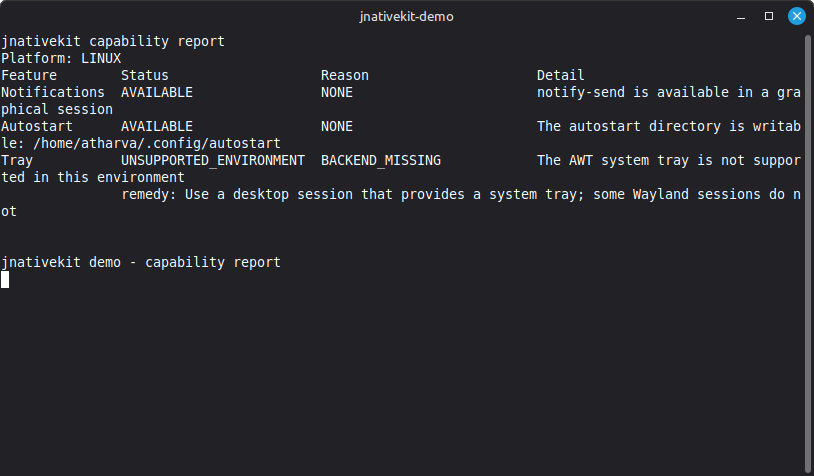

# jnativekit

One small Java 17 library for desktop **notifications**, **autostart** and **system tray** on
Linux, Windows and macOS, built around an honest result model: every call reports what was
actually verified, and every unavailable feature explains why and what to do about it.

**Status: v0.1.0, pre-1.0.** The three features are implemented. Manual verification is limited to
the owner's single Linux machine; Windows and macOS are exercised by CI tests only and are **not
manually verified**. The artifacts are not on Maven Central yet (that is a separate, later
decision); build from source for now. Read the [support matrix](#support-matrix) before relying on
a cell.

## The problem

A Java desktop application that wants a notification, a tray icon or "start at login" has to
combine AWT, shell tools, OS-specific files and registry keys, and then guess whether it worked.
Failures are usually silent: a notification command returns exit code 0 and nothing appears; a
tray icon is accepted by AWT and never shown; an autostart entry is written to a place the OS
ignores.

jnativekit gives you one API, a capability check before you act, and a result that says exactly
what happened.

## What you get

- One API for three features, selected per OS at runtime.
- `Capability` before every action: `AVAILABLE`, `UNSUPPORTED_OS`, `UNSUPPORTED_ENVIRONMENT`,
  `MISSING_DEPENDENCY` or `PERMISSION_DENIED`, with a machine-readable `Reason`, human `detail`
  and a `remedy` where one can be offered.
- `Result<T>` that distinguishes `CONFIRMED`, `DISPATCHED_UNVERIFIED`, `UNAVAILABLE` and
  `FAILED`, and names the provider that ran.
- Zero runtime dependencies; works with Swing, JavaFX or no UI framework.
- Process execution through `ProcessBuilder` argument lists, never a shell, with a timeout.
- No reflection tricks, no DI framework, no logging framework. `System.Logger` only.

## Build from source

Requires JDK 17 and Maven.

```bash
git clone https://github.com/atharvashelkeatwork/jnativekit.git
cd jnativekit
mvn -B verify                 # unit + unit-fake tests; must pass on Linux, Windows, macOS
mvn -B verify -Pintegration   # adds the ci-integration tier
```

## Quick start

The example below is compiled by `ReadmeExampleTest` in the `demo` module, so it stays valid
against the public API.

```java
import io.github.atharvashelkeatwork.jnativekit.*;
import java.nio.file.Files;
import java.nio.file.Path;
import java.util.List;

Capability caps = Desktop.notifications().capability();
if (caps.status() != Capability.Status.AVAILABLE) {
    System.out.println(caps.reason() + ": " + caps.remedy());
} else {
    Result<Void> result = Desktop.notifications()
            .show(Notification.of("Backup done", "42 files synced"));
    System.out.println(result.status() + " via " + result.provider());
}

Result<Void> autostart = Desktop.autostart().enable(new AutostartEntry(
        "com.example.notes", "Example Notes",
        Path.of(System.getProperty("java.io.tmpdir"), "notes"), List.of("--minimized")));
System.out.println("autostart: " + autostart.status());

byte[] iconPng = Files.readAllBytes(Path.of("icon.png"));
Result<TrayHandle> tray = Desktop.tray().open(new TrayIcon(
        iconPng, "Example Notes",
        List.of(TrayMenuItem.item("Quit", () -> System.exit(0)))));
System.out.println("tray: " + tray.status());
```

`Desktop` accessors never return `null` and never throw. If no provider matches, they return a
facade whose capability is `UNSUPPORTED_OS` and whose actions return `UNAVAILABLE`.

### What `CONFIRMED` means — and does not mean

| Feature | `CONFIRMED` means | It never means |
|---|---|---|
| Notifications | Not reachable in v0.1; notifications are always `DISPATCHED_UNVERIFIED` | that the user saw it, or that Do Not Disturb is off |
| Autostart enable | the entry was written and read back equal to the request | that the OS will definitely run it (startup settings can disable it) |
| Autostart disable | the entry was removed and read back as absent | — |
| Autostart `isEnabled` | the store was read successfully and the value is the truth it contains | that an unreadable store is `false` (it returns `FAILED`) |
| Tray open | AWT accepted the icon (`SystemTray.add` returned without error) | that the icon is visible (some desktops hide legacy tray icons) |

Do not branch on `detail` text. Branch on `status` and `reason`.

## Support matrix

Values follow the vocabulary in [docs/TESTING.md](docs/TESTING.md), which also holds the detailed
log. The `manual-verified` cells are the owner's Linux runs on 2026-11-04. The owner has no
Windows or macOS machine, so those columns come from CI and the unit tiers only and are never
`manual-verified`.

| Feature | Linux Mint (Cinnamon, X11) | Windows 10/11 | macOS | Other |
|---|---|---|---|---|
| Notifications | manual-verified (2026-11-04) | unit-fake only | unit-fake only | untested |
| Autostart | manual-verified (2026-11-04) | ci-integration | ci-integration | untested |
| Tray | manual-verified (2026-11-04)¹ | unit-fake only | unit-fake only | untested |

The owner has one Linux machine and no Windows or macOS machine, so those two columns can never
carry a manual-verified cell. `ci-integration` means the real OS ran the T3 test in CI (for
autostart: a throwaway `Run` value written, read and deleted on `windows-latest`; a LaunchAgent in a
temp HOME on `macos-latest`). Notifications and tray visibility cannot be exercised without a
desktop, so they remain `unit-fake only` there.

¹ The Linux session available for testing exposes StatusNotifier (`xapp-sn-watcher`), not an
XEmbed tray. `SystemTray.isSupported()` is therefore `false`, `capability()` correctly reports
`UNSUPPORTED_ENVIRONMENT`/`BACKEND_MISSING`, and no icon is shown. That is recorded as an
environment limitation, not hidden as a working tray. A desktop with an XEmbed tray is expected to
show the icon; the AWT acceptance is still not a visibility promise.

## Limitations in v0.1

- **Notifications** are Linux `notify-send`, a Windows AWT tray balloon, or macOS `osascript`.
  No buttons, images, sounds, progress or replacement. Visibility depends on the desktop and on
  Do Not Disturb / Focus Assist; the library reports `DISPATCHED_UNVERIFIED`, never `CONFIRMED`.
- **Autostart** means "when this user logs into a graphical desktop session". Not at boot, not
  before login, not for other users. Installers must place the executable before enabling.
- **Tray** has one icon per `open` call, a fixed menu, and callbacks on the daemon thread
  `jnativekit-callbacks`. The tray does not keep the JVM alive. Legacy XEmbed desktops may hide
  the icon; StatusNotifier-only desktops report the feature as unavailable.
- **Windows and macOS** are covered by unit, unit-fake and ci-integration tests only. No one has
  run the demo on either; the owner has one Linux machine and no Windows or macOS machine.
- **Wayland, other BSDs, JVMs older than 17** are not supported.
- Credential storage, global hotkeys, file watching, clipboard and dialogs are later versions.

## Prior art

This library reuses AWT `SystemTray` rather than replacing it, and does not vendor other
projects. Re-check each project's status before assuming a comparison still holds.

| Existing | Covers | Why jnativekit is still different |
|---|---|---|
| AWT `SystemTray` | Tray on most platforms | Reused. jnativekit adds capability checks, lifecycle and callback rules. |
| TwoSlices | Notifications | Notifications alone are not the pitch. |
| JNativeHook | Global keyboard hooks | Out of scope for v0.1 (hotkeys are v0.3). |
| java-keyring | Credential storage | Out of scope for v0.1 (secrets are v0.2). |
| JWM / Nucleus | Window/desktop frameworks | Different scope: frameworks, not a small library. |

The claim jnativekit tries to defend: *a Java developer gets reliable feature detection, clear
failure reasons and consistent semantics with less glue code than assembling these pieces by
hand.* The demo and tests are how that claim is demonstrated, not this paragraph.

## Demo

```bash
mvn -B -pl demo -am package exec:java
# or, after packaging:
java -jar demo/target/jnativekit-demo-0.1.0.jar --report
```

`--report` prints one capability row per feature and exits. With no flag the demo prints the
report and opens an interactive menu: send a notification, toggle autostart, open a tray icon
with Quit, or reprint the report. `--autostart` is the login mode used by the demo's own autostart
entry: it sends a notification, opens the tray icon and waits for Quit.



The demo on the owner's Linux Mint 22.3 / Cinnamon / X11 machine. Notifications and autostart are
`AVAILABLE`; the tray is reported as `UNSUPPORTED_ENVIRONMENT` / `BACKEND_MISSING` because Cinnamon
exposes StatusNotifier rather than an XEmbed tray. On Windows and macOS only CI and unit/unit-fake
tests exercise the code; neither is manually verified.

## Documentation

- [Scope](docs/SCOPE.md) — what is in and out of v0.1
- [API contract](docs/API.md) — the frozen public contract
- [Architecture](docs/ARCHITECTURE.md) — modules, providers, process execution
- [Testing](docs/TESTING.md) — test tiers, manual checklists, verification log
- [Milestones](docs/MILESTONES.md) — how the project was built
- [Changelog](CHANGELOG.md) · [Contributing](CONTRIBUTING.md) · [Security](SECURITY.md)

## License

Apache License, Version 2.0 — see [LICENSE](LICENSE).
